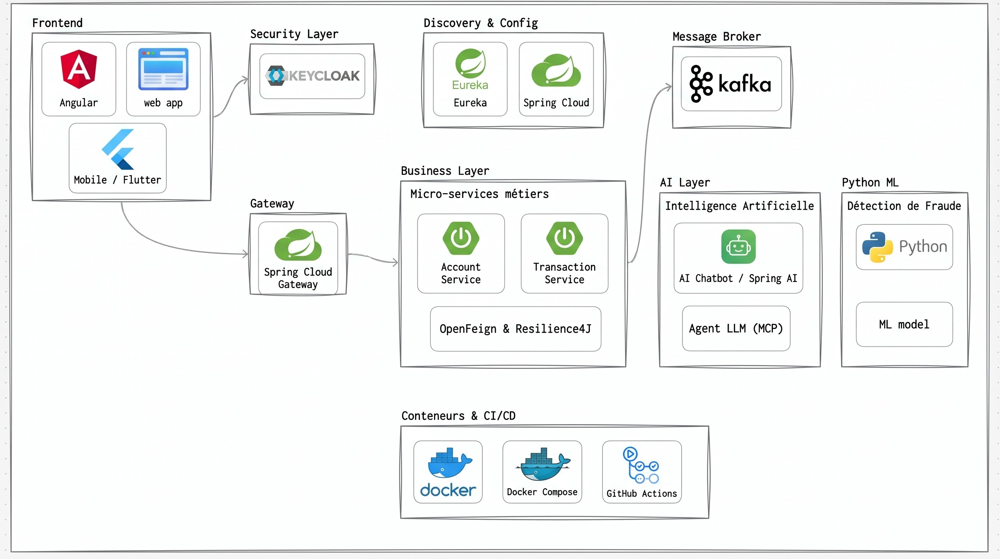

# Rapport Technique — Épreuve de Sélection
## Architecture Micro-services, IA & Développement Full-Stack

**Institution :** ENSET Mohammedia  
**Entreprise partenaire :** ADRIA Business & Technology  
**Candidat :** Amine Edarkaoui  
**Dépôt GitHub :** [amine-edarkaoui-test-adria-pfe-27](https://github.com/amineedarkaoui/amine-edarkaoui-test-adria-pfe-27)  
**Date :** Octobre 2026  

---

## Sommaire
- [1. Contexte du Projet](#1-contexte-du-projet)
- [2. Partie B — Conception et Architecture](#2-partie-b--conception-et-architecture)
- [3. Partie C — Micro-services Fonctionnels](#3-partie-c--micro-services-fonctionnels)

---

## 1. Contexte du Projet

Mise en place d'une plateforme bancaire distribuée permettant la gestion des comptes bancaires, l'enregistrement des transactions avec détection de fraude (Machine Learning), une communication événementielle asynchrone via Kafka, un assistant conversationnel basé sur Spring AI / MCP, ainsi qu'une interface utilisateur et une chaîne DevOps complète.

---

## 2. Partie B — Conception et Architecture

### 2.1. Diagramme de Classes Métier

Le modèle métier s'articule autour de deux entités principales réparties au sein de microservices dédiés :
- **Account (`account-service`)** : Gère l'état du compte bancaire (`id`, `customerReference`, `status` [ACTIVE | BLOCKED], `currency`, `balance`).
- **Transaction (`transaction-service`)** : Enregistre les opérations financières associées à un compte (`id`, `accountId`, `amount`, `currency`, `merchantCategory`, `country`, `createdAt`).

---

### 2.2. Schéma d'Architecture Globale

L'architecture technique est structurée en plusieurs couches découplées :
- **Clients** : Interface web Angular et application mobile Flutter.
- **Sécurité & Accès** : Authentification et autorisation centralisées via Keycloak ; routage via Spring Cloud Gateway.
- **Services Techniques** : Découverte d'instances (Eureka) et centralisation des configurations (Spring Cloud Config).
- **Couche Métier** : `account-service` et `transaction-service`, communiquant via OpenFeign avec tolérance aux pannes (Resilience4J).
- **Communication Asynchrone** : Broker d'événements Kafka pour la diffusion des transactions.
- **Intelligence Artificielle** : Assistant conversationnel (Spring AI / serveurs MCP) et modèle Python ML pour la détection de fraude.
- **Conteneurisation & CI/CD** : Docker, Docker Compose et pipelines automatisés GitHub Actions.

---

## 3. Partie C — Micro-services Fonctionnels

Chaque microservice métier respecte une stricte séparation en couches (`domain/`, `repository/`, `service/`, `web/rest/`, `web/graphql/`, `mcp/`), où les trois points d'entrée (REST, GraphQL et MCP) s'appuient sur une couche service partagée.

### 3.1. Account-Service
Gestion du cycle de vie des comptes bancaires (création, consultation, gestion des statuts ACTIVE / BLOCKED).

- **Endpoints REST :**
  > 📸 *[Capture d'écran : Test des endpoints REST (Postman / Swagger / cURL)]*

- **Requêtes & Mutations GraphQL :**
  > 📸 *[Capture d'écran : Interface GraphiQL / Requête de consultation et mutation]*

- **Serveur MCP (Model Context Protocol) :**
  > 📸 *[Capture d'écran : Outil MCP d'interrogation de compte fonctionnel]*

---

### 3.2. Transaction-Service
Enregistrement des opérations bancaires avec validation stricte des règles métier :
- Montant strictement positif et inférieur au plafond configuré.
- Compte existant et actif.
- Correspondance stricte de devise entre le compte et la transaction.
- Vérification et mise à jour automatique du solde.
- Prise en charge des opérations de virement compte à compte.

- **Endpoints REST :**
  > 📸 *[Capture d'écran : Enregistrement d'une transaction via REST]*

- **API GraphQL :**
  > 📸 *[Capture d'écran : Requête / Mutation de transaction en GraphQL]*

- **Outils MCP :**
  > 📸 *[Capture d'écran : Déclenchement d'une transaction via un outil MCP]*

---

### 3.3. Communication Inter-services (OpenFeign & Resilience4J)
Communication synchrone entre `transaction-service` et `account-service` pour la vérification et la mise à jour du solde :
- Client déclaratif **Spring Cloud OpenFeign**.
- Tolérance aux pannes avec **Resilience4J** (Circuit Breaker et mécanisme de Fallback).

> 📸 *[Capture d'écran : Démonstration du Fallback / Circuit Breaker en cas d'indisponibilité d'Account-Service]*
