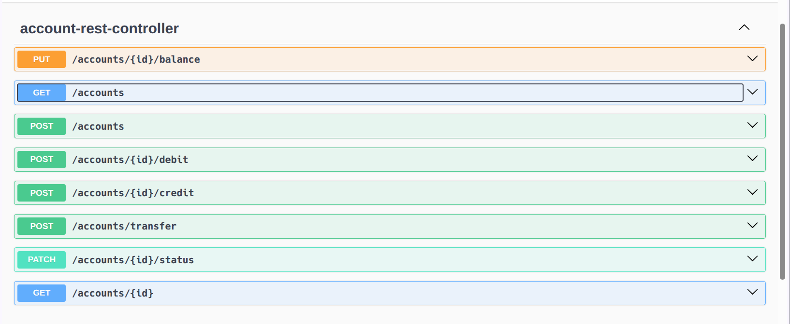
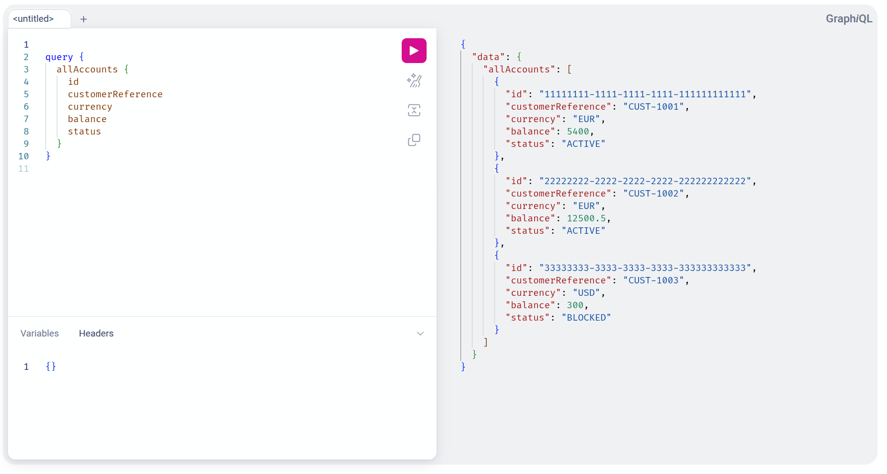
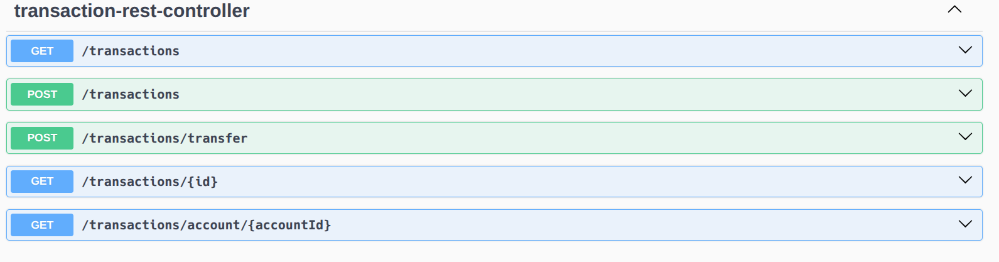
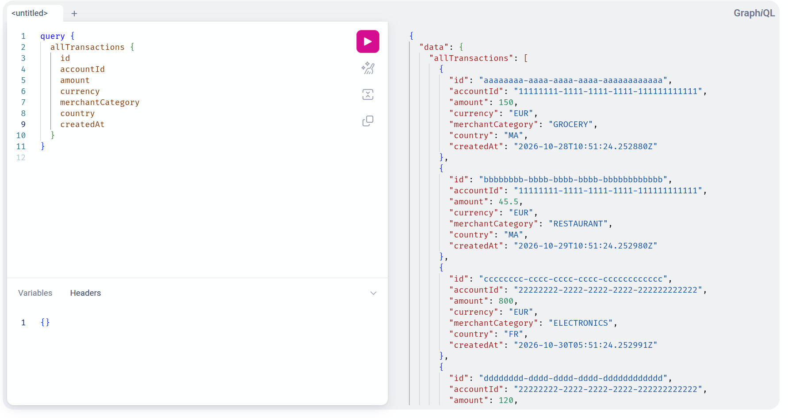
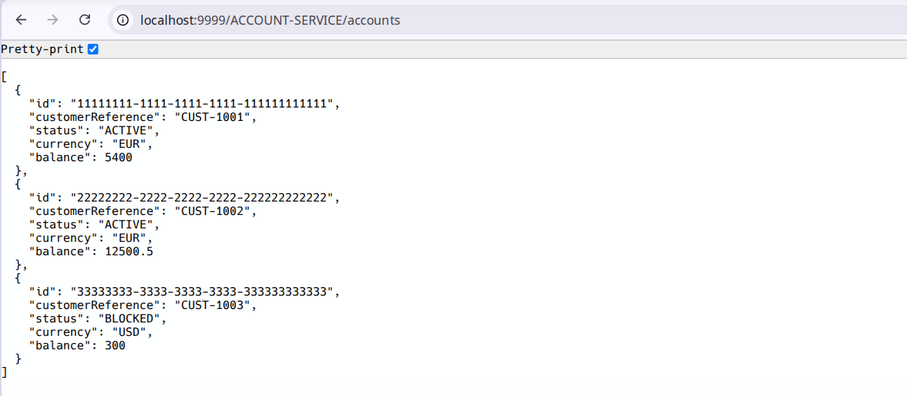
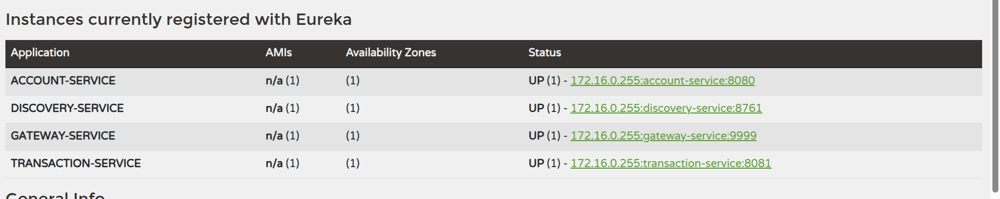

# Rapport Technique — Épreuve de Sélection
## Architecture Micro-services, IA & Développement Full-Stack

**Institution :** ENSET Mohammedia  
**Entreprise partenaire :** ADRIA Business & Technology  
**Candidat :** Amine Edarkaoui  
**Dépôt GitHub :** [amine-edarkaoui-test-adria-pfe-27](https://github.com/amineedarkaoui/amine-edarkaoui-test-adria-pfe-27)  
**Date :** Octobre 2026  

---

## Sommaire
- [1. Contexte du Projet](#1-contexte-du-projet)
- [2. Partie B — Conception et Architecture](#2-partie-b--conception-et-architecture)
- [3. Partie C — Micro-services Fonctionnels](#3-partie-c--micro-services-fonctionnels)
- [4. Partie D — Micro-services Techniques](#4-partie-d--micro-services-techniques)

---

## 1. Contexte du Projet

Mise en place d'une plateforme bancaire distribuée permettant la gestion des comptes bancaires, l'enregistrement des transactions avec détection de fraude (Machine Learning), une communication événementielle asynchrone via Kafka, un assistant conversationnel basé sur Spring AI / MCP, ainsi qu'une interface utilisateur et une chaîne DevOps complète.

---

## 2. Partie B — Conception et Architecture

### 2.1. Diagramme de Classes Métier

Le modèle métier s'articule autour de deux entités principales réparties au sein de microservices dédiés :
- **Account (`account-service`)** : Gère l'état du compte bancaire (`id`, `customerReference`, `status` [ACTIVE | BLOCKED], `currency`, `balance`).
- **Transaction (`transaction-service`)** : Enregistre les opérations financières associées à un compte (`id`, `accountId`, `amount`, `currency`, `merchantCategory`, `country`, `createdAt`).


---

### 2.2. Schéma d'Architecture Globale

L'architecture technique est structurée en plusieurs couches découplées :
- **Clients** : Interface web Angular et application mobile Flutter.
- **Sécurité & Accès** : Authentification et autorisation centralisées via Keycloak ; routage via Spring Cloud Gateway.
- **Services Techniques** : Découverte d'instances (Eureka) et centralisation des configurations (Spring Cloud Config).
- **Couche Métier** : `account-service` et `transaction-service`, communiquant via OpenFeign avec tolérance aux pannes (Resilience4J).
- **Communication Asynchrone** : Broker d'événements Kafka pour la diffusion des transactions.
- **Intelligence Artificielle** : Assistant conversationnel (Spring AI / serveurs MCP) et modèle Python ML pour la détection de fraude.
- **Conteneurisation & CI/CD** : Docker, Docker Compose et pipelines automatisés GitHub Actions.


---

## 3. Partie C — Micro-services Fonctionnels

Chaque microservice métier respecte une stricte séparation en couches (`domain/`, `repository/`, `service/`, `web/rest/`, `web/graphql/`, `mcp/`), où les trois points d'entrée (REST, GraphQL et MCP) s'appuient sur une couche service partagée.

### 3.1. Account-Service
Gestion du cycle de vie des comptes bancaires (création, consultation, gestion des statuts ACTIVE / BLOCKED, débit, crédit et virement).

- **Endpoints REST (Swagger / OpenAPI) :**



- **Requêtes & Mutations GraphQL (GraphiQL) :**



- **Serveur MCP (Model Context Protocol) :**
  Exposition des outils `@McpTool` dans `AccountMcpTools` (`getAllAccounts`, `getAccountById`, `createAccount`, `creditAccount`, `debitAccount`, `transfer`, `updateAccountStatus`) permettant l'automatisation des opérations de compte par des agents LLM.

---

### 3.2. Transaction-Service
Enregistrement des opérations bancaires avec validation stricte des règles métier :
- Montant strictement positif et inférieur au plafond configuré (`bank.transaction.max-amount`).
- Compte existant et actif.
- Correspondance stricte de devise entre le compte et la transaction.
- Vérification et mise à jour automatique du solde.
- Prise en charge des opérations de virement compte à compte.

- **Endpoints REST (Swagger / OpenAPI) :**



- **API GraphQL (GraphiQL) :**



- **Outils MCP :**
  Exposition des outils `@McpTool` dans `TransactionMcpTools` (`getAllTransactions`, `getTransactionById`, `getTransactionsByAccountId`, `recordTransaction`, `executeTransfer`) appliquant l'ensemble des règles de validation métier.

---

### 3.3. Communication Inter-services (OpenFeign & Resilience4J)
La communication synchrone entre `transaction-service` et `account-service` est assurée par un client déclaratif **Spring Cloud OpenFeign**, sécurisé par un Circuit Breaker **Resilience4J** pour la tolérance aux pannes avec mécanisme de Fallback :

```java
@FeignClient(name = "account-service", url = "${account.service.url:http://localhost:8080}")
public interface AccountServiceClient {

    @GetMapping("/accounts/{id}")
    @CircuitBreaker(name = "accountService", fallbackMethod = "getDefaultAccount")
    AccountDTO getAccountById(@PathVariable UUID id);

    default AccountDTO getDefaultAccount(UUID id, Exception e) {
        return AccountDTO.builder()
                .id(id)
                .customerReference("Not available")
                .status("BLOCKED")
                .currency("EUR")
                .balance(0.0)
                .build();
    }

    @PutMapping("/accounts/{id}/balance")
    @CircuitBreaker(name = "accountService", fallbackMethod = "getDefaultUpdateBalance")
    AccountDTO updateBalance(@PathVariable UUID id, @RequestBody Map<String, Double> request);

    default AccountDTO getDefaultUpdateBalance(UUID id, Map<String, Double> request, Exception e) {
        return getDefaultAccount(id, e);
    }

    @PostMapping("/accounts/{id}/debit")
    @CircuitBreaker(name = "accountService", fallbackMethod = "getDefaultDebit")
    AccountDTO debit(@PathVariable UUID id, @RequestBody Map<String, Double> request);

    default AccountDTO getDefaultDebit(UUID id, Map<String, Double> request, Exception e) {
        return getDefaultAccount(id, e);
    }

    @PostMapping("/accounts/{id}/credit")
    @CircuitBreaker(name = "accountService", fallbackMethod = "getDefaultCredit")
    AccountDTO credit(@PathVariable UUID id, @RequestBody Map<String, Double> request);

    default AccountDTO getDefaultCredit(UUID id, Map<String, Double> request, Exception e) {
        return getDefaultAccount(id, e);
    }
}
```

En cas d'indisponibilité d'`account-service`, la méthode `getDefaultAccount` retourne un compte dégradé (`BLOCKED`), empêchant tout enregistrement de transaction invalide et évitant un crash de `transaction-service`.

---

## 4. Partie D — Micro-services Techniques

Mise en place de l'infrastructure Spring Cloud pour la découverte, la centralisation des configurations et le routage des requêtes.

### 4.1. Spring Cloud Gateway
Mise en place de la passerelle Spring Cloud Gateway (port `9999`) comme point d'entrée unique de la plateforme. Grâce à l'intégration avec Eureka (Discovery Locator), les requêtes sont dynamiquement acheminées vers les microservices sous-jacents (ex. `/ACCOUNT-SERVICE/accounts`).



---

### 4.2. Eureka Discovery Service
Déploiement du serveur de découverte Eureka (`discovery-service` sur le port `8761`) permettant l'enregistrement et la résolution dynamique des instances des microservices (`ACCOUNT-SERVICE`, `TRANSACTION-SERVICE` et `GATEWAY-SERVICE`).


