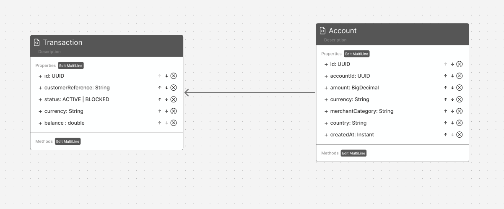

# Rapport Technique — Épreuve de Sélection
## Architecture Micro-services, IA & Développement Full-Stack

**Institution :** ENSET Mohammedia  
**Entreprise partenaire :** ADRIA Business & Technology  
**Candidat :** Amine Edarkaoui  
**Dépôt GitHub :** [amine-edarkaoui-test-adria-pfe-27](https://github.com/amineedarkaoui/amine-edarkaoui-test-adria-pfe-27)  
**Date :** Octobre 2026  

---

## Sommaire
- [1. Contexte du Projet](#1-contexte-du-projet)
- [2. Partie B — Conception et Architecture](#2-partie-b--conception-et-architecture)

---

## 1. Contexte du Projet

Mise en place d'une plateforme bancaire distribuée permettant la gestion des comptes bancaires, l'enregistrement des transactions avec détection de fraude (Machine Learning), une communication événementielle asynchrone via Kafka, un assistant conversationnel basé sur Spring AI / MCP, ainsi qu'une interface utilisateur et une chaîne DevOps complète.

---

## 2. Partie B — Conception et Architecture

### 2.1. Diagramme de Classes Métier

Le modèle métier s'articule autour de deux entités principales réparties au sein de microservices dédiés :
- **Account (`account-service`)** : Gère l'état du compte bancaire (`id`, `customerReference`, `status` [ACTIVE | BLOCKED], `currency`, `balance`).
- **Transaction (`transaction-service`)** : Enregistre les opérations financières associées à un compte (`id`, `accountId`, `amount`, `currency`, `merchantCategory`, `country`, `createdAt`).

---

### 2.2. Schéma d'Architecture Globale

